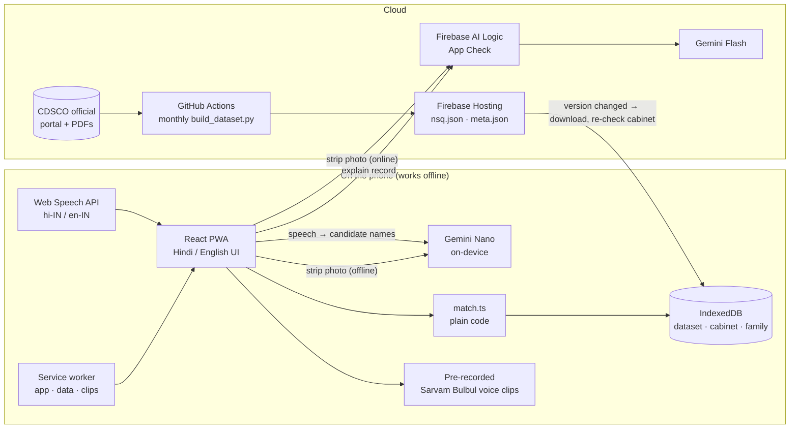

# DawaShield · दवा कवच

**A medicine companion for every Indian home.** Speak in Hindi or English, or show a photo of a medicine strip, and DawaShield checks your family's medicines against official **CDSCO** drug-quality alerts (NSQ = Not of Standard Quality, and spurious). It works **even without internet**.

> Your mother's medicine cabinet shouldn't need an internet connection, English literacy or a technical understanding of batch numbers to stay informed about medicine safety.

Entry for Google's **#BuildHybridAI 2026** hackathon. Live: **https://dawashield-hybrid-3023.web.app**

---

## The problem

Every month CDSCO, India's drug regulator, and the state drug labs publish lists of medicine batches that failed quality tests or were found to be fake. They come out as PDFs and tables on a government website, in English, organised by batch number. The people most at risk (elderly parents managing five strips a day, families in small towns, anyone who reads Hindi more easily than English) are the least likely to ever see them.

## What DawaShield does

| # | Feature | How |
|---|---|---|
| 1 | **Voice check** (Hindi / English) | Guided flow: say the medicine → pick from 2–4 big cards → give the batch → result |
| 2 | **Photo check** | Snap the strip; AI reads name, batch, manufacturer, expiry; you confirm |
| 3 | **Offline mode** | PWA caches the app, the full dataset and voice clips; on-device Gemini Nano |
| 4 | **Sourced result** | Red / amber / grey card with the full government record and a link to the CDSCO source |
| 5 | **Home medicine cabinet** | Save medicines per person (Maa, Papa…); auto re-check on every new dataset and monthly |
| 6 | **Expiry reminder** | Valid / Expires soon / Expired badges, local notification ~5 days before, official disposal tip |
| 7 | **Family alert** | One tap opens WhatsApp (`wa.me`) with a pre-filled message; queued if offline |
| 8 | **Report it** | Pre-filled complaint + verified official channels (CDSCO, PvPI) |

## Safety rules (non-negotiable)

- The app **never says a medicine is safe**. There are only three results:
  - 🟥 **RED, official alert found.** The batch and medicine match a CDSCO alert. *"Please speak to your pharmacist or doctor before taking the next dose. Do not suddenly stop an important medicine on your own."*
  - 🟧 **AMBER, please confirm.** The batch is one character off for the same medicine, *or* the same batch is listed under a different name, *or* the exact company entity has official action but this batch is not listed (*"this does not mean all batches are affected"*).
  - ⬜ **GREY, no alert found** in the downloaded data. *"This is not a safety guarantee."*
- No alternative medicines, doses, or medical or first-aid advice. Ever.
- **Matching is plain, tested code** (`src/lib/match.ts`). AI never decides the colour and never writes a safety message.
- Every safety and error message is pre-written in Hindi and English in one file: [`src/content/messages.ts`](src/content/messages.ts).
- Colour is always paired with an icon and a word.
- A disclaimer sits on the home screen and every result.

## Architecture



## Hybrid AI (Firebase AI Logic)

| Task | Where | Mode |
|---|---|---|
| Hindi/English speech to text | Browser Web Speech API, on-device with the language pack | — |
| Understand spoken/typed medicine name → candidate names (strict JSON) | **Gemini Nano on device** first, Flash fallback | `PREFER_ON_DEVICE` |
| Read photo of strip → `{name, manufacturer, batch, expiry}` (strict JSON) | **Gemini Flash** in cloud when online; **Nano** when offline | `PREFER_IN_CLOUD` / `ONLY_ON_DEVICE` |
| Match batch to CDSCO list | Plain code on device | — |
| Safety message | Fixed pre-written text + recorded clip, **never generated** | — |
| Simple explanation of the record | Flash in cloud; Nano single-turn when offline | `PREFER_IN_CLOUD` / `ONLY_ON_DEVICE` |
| Follow-up questions about the record | Flash in cloud (multi-turn chat) | `ONLY_IN_CLOUD` |
| Download new list / cabinet re-check / expiry | Cloud fetch / plain code on device | — |

Every AI output carries a visible chip, **"On this device" / "Cloud"** (Hindi: **"इसी फ़ोन पर" / "क्लाउड"**), mapped from `response.inferenceSource` (`"on_device"` / `"in_cloud"`) in [`src/lib/source.ts`](src/lib/source.ts). Model JSON is never trusted: code fences are stripped and the JSON is schema-checked ([`src/lib/json.ts`](src/lib/json.ts)).

## Data: official CDSCO only

- **Sources:** the CDSCO public NSQ/spurious alert portal ([cdscoonline.gov.in/CDSCO/viewPublicNSQDrug](https://cdscoonline.gov.in/CDSCO/viewPublicNSQDrug)), which is the "new link" announced in the DCGI notice of 28 Aug 2025, and the monthly alert PDFs on [cdsco.gov.in](https://cdsco.gov.in/opencms/opencms/en/Notifications/Alerts/).
- **Builder:** [`data/build_dataset.py`](data/build_dataset.py) downloads both, keeps NSQ and spurious separate, cleans fields, adds a normalised batch and an **exact** manufacturer entity key (only legal suffixes are dropped, so "Sresan Pharmaceuticals" ≠ "Sresan Pharma"), and cross-checks each portal row against the text of the official PDF for that month where one exists.
- **Coverage (this build):** **4,158 records** (4,109 NSQ, 49 spurious), alert months **October 2024 to September 2026**. 815 records were also found word-for-word in an official monthly PDF. 55 records were checked by hand and are listed in [`data/verified_records.csv`](data/verified_records.csv).
- **Limits:** some states do not send monthly data (the portal lists states pending for each month; these are shown in Settings). A GREY result only means "not in the downloaded list".
- **Freshness:** a GitHub Actions workflow ([`.github/workflows/dataset.yml`](.github/workflows/dataset.yml)) rebuilds the dataset monthly. The app fetches `meta.json` on start; if the version changed it downloads `nsq.json` into IndexedDB and re-checks the cabinet.

## Privacy

Voice is never recorded or uploaded. Photos are never stored; when online only the single photo being read is sent to Gemini via Firebase AI Logic. The cabinet and family numbers live only in the phone's IndexedDB. No accounts, no analytics.

## Run it

```bash
npm install
npm test               # Vitest: matching engine, JSON parsing, source labels, expiry
npm run build
npm run preview        # http://localhost:4173
npm run data           # rebuild public/data from CDSCO (Python 3.12 + pdfplumber)
npm run audio          # regenerate voice clips with Sarvam AI Bulbul (needs SARVAM_API_KEY in .env)
node scripts/shots.mjs "<medicine>" "<batch>"   # Playwright screenshots + offline test
```

**App Check:** on localhost the debug provider is used (put a registered token in `.env.local` as `VITE_APPCHECK_DEBUG_TOKEN`, or register the one Chrome prints). For a hosted build set `VITE_RECAPTCHA_V3_SITE_KEY` (or `VITE_RECAPTCHA_ENTERPRISE_SITE_KEY`) in `.env.production.local`.

### Browser requirements for on-device AI

- Desktop **Chrome** with the built-in Prompt API (Gemini Nano), with about 22 GB free disk and a GPU with more than 4 GB VRAM (or 16 GB RAM).
- Gemini Nano downloaded (`chrome://on-device-internals`).
- Image input flag: `chrome://flags/#prompt-api-for-gemini-nano-multimodal-input` → Enabled.
- Hindi on-device speech: the Hindi offline speech pack installed.
- Without Nano, everything still works online through Gemini Flash, and matching always works offline.

## Credits

Built with Cursor and Claude Code. Data: Central Drugs Standard Control Organisation (CDSCO), Government of India. Voices: Sarvam AI Bulbul v4 Flash (ritu_hi_customer_warm for Hindi, neha_en_customer for English). MIT licence.

*DawaShield does not replace a pharmacist, doctor or official advice.*
