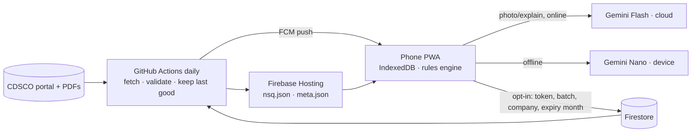

# DawaShield · दवा कवच

**A medicine companion for every Indian home.** Speak in Hindi or English, type, or show a photo of a medicine strip, and DawaShield checks your family's medicines against official **CDSCO** drug-quality alerts (NSQ = Not of Standard Quality, and spurious). The check **works without internet, on cheap Android phones**.

> Your mother's medicine cabinet shouldn't need an internet connection, English literacy or a technical understanding of batch numbers to stay informed about medicine safety.

Entry for Google's **#BuildHybridAI 2026** hackathon. Live: **https://dawashield-hybrid-3023.web.app**

---

## The problem

CDSCO, India's drug regulator, and the state drug labs publish lists of medicine batches that failed quality tests or were found to be fake. They come out about a month late, as PDFs and tables on a government website, in English, organised by batch number. The people most at risk (elderly parents managing five strips a day, families in small towns, anyone who reads Hindi more easily than English) are the least likely to ever see them.

## Features

| | Feature | How |
|---|---|---|
| 1 | **Voice check (Hindi / English)** | Say the medicine name. Garbled speech-to-text is matched **offline** with Hindi-aware phonetic + fuzzy matching against a 2,600+ name dictionary; pick from 2–4 big buttons |
| 2 | **Photo check** | Auto-crop, grayscale, glare reduction, CLAHE contrast boost, sharpen → two AI reads → per-field confidence; low confidence = amber "please confirm". Second photo merges fields. Big-button batch keypad always one tap away |
| 3 | **Works offline on any phone** | Installable PWA; full dataset in IndexedDB (~0.5 MB download); matching is pure rule-based code. Gemini Nano / Flash are extras, with capability detection and fallback |
| 4 | **Honest, sourced results** | RED / AMBER / GREY with CDSCO alert month, official link and record ID on every answer; "Verified" badge on hand-checked records; "Official data checked up to" + "Last updated" |
| 5 | **Company entity resolution** | Normalised names, alias table, token-set similarity with a confidence score |
| 6 | **Home medicine cabinet** | Saved medicines are re-checked **daily**; opt-in **web push** even when the app is closed (flagged batches + expiry ~5 days before); calendar (.ics) fallback |
| 7 | **Family alerts** | WhatsApp message, or optional push to a family member's phone after they accept an invite link |
| 8 | **Report it** | Pre-filled CDSCO complaint (email, toll-free) and PvPI; "Report a wrong result" (no personal data) |
| 9 | **Try a demo** | Real RED batches 251TTF014, P03524, 054A003 from the official list |
| 10 | **Hindi + English everywhere** | Pre-written templates for every result type, pre-recorded Sarvam AI voice clips; works offline |

## Safety rules (non-negotiable)

- **The colour is decided by plain, tested code** ([`src/lib/match.ts`](src/lib/match.ts)), never by AI.
  - 🟥 **RED, official alert found:** exact batch + exact/high-confidence company (or matching medicine name). *"Don't take the next dose until you speak to your doctor or chemist. Never stop an essential medicine suddenly."*
  - 🟧 **AMBER, possible match:** exact batch + medium-confidence or different company, batch one character / OCR look-alike off, or the company has official action but this batch is not listed (*"the alert covers only the listed batches, not all of this company's batches"*).
  - ⬜ **GREY:** *"No official alert found for this batch. This does not mean the medicine is tested safe. CDSCO lists come out late."* Followed by next steps: check expiry, buy from a licensed chemist with a bill, save for automatic alerts, report a suspicious medicine.
- **Never recommends any medicine**, dose or treatment.
- Every safety message is pre-written in Hindi and English ([`src/content/messages.ts`](src/content/messages.ts), [`src/content/templates.ts`](src/content/templates.ts)).
- First-run disclaimer (Hindi + English), privacy page, disclaimer on every result.

## How it works

Full details and diagrams: **[docs/ARCHITECTURE.md](docs/ARCHITECTURE.md)**: data pipeline, hybrid AI router, offline matching engine, entity resolution, push re-check loop, privacy design.



| Task | Where |
|---|---|
| Speech → medicine name | Web Speech API + **offline phonetic matcher**; Nano/Flash add candidates when available |
| Strip photo → fields | Preprocessing on device → **Gemini Flash** (cloud) online, **Gemini Nano** offline |
| Match batch / company | **Plain code on device** |
| Explanation | **Pre-written Hindi/English templates (offline)**; Flash for more detail online |
| New data, re-check, push | GitHub Actions (free), Firebase Admin SDK, FCM |

Every AI answer shows **"On this device"** or **"Cloud"**, taken from the SDK's `inferenceSource`.

## Data source

- **Official CDSCO only:** the public NSQ/spurious alert portal ([cdscoonline.gov.in/CDSCO/viewPublicNSQDrug](https://cdscoonline.gov.in/CDSCO/viewPublicNSQDrug)) and monthly alert PDFs on [cdsco.gov.in](https://cdsco.gov.in/opencms/opencms/en/Notifications/Alerts/).
- **Coverage:** **4,158 records** (4,109 NSQ, 49 spurious), alert months **October 2024 to September 2026**; 815 cross-checked word-for-word against an official PDF; **55 checked by hand** ([`data/verified_records.csv`](data/verified_records.csv)).
- **Daily pipeline** ([`.github/workflows/dataset.yml`](.github/workflows/dataset.yml)): fetch → parse → normalise → dedupe → **validate** ([`data/validate.py`](data/validate.py)). If the source is down or the parse looks wrong (sharp record drop, missing fields, month going backwards), the last good data is kept and the failure is logged in [`data/pipeline_log.json`](data/pipeline_log.json). Added records are listed in [`data/CHANGELOG.md`](data/CHANGELOG.md).

## Evaluation

`npm run eval` → **[docs/EVAL.md](docs/EVAL.md)** (also shown in the app under "How it works").

| | Result |
|---|---|
| Matching, 428 labelled cases from the 55 verified records + hard cases (spelling, spacing, company variants, OCR 0/O 1/I 5/S) + negatives | **Precision 100% · Recall 100% · False-GREY 0%** (RED on 97.4% of exact cases; the rest AMBER) |
| Hindi/English speech, 60 garbled transcripts | **Top-1 98.3% · Top-3 100%** |
| Photo | Ready: drop strip photos + labels in [`data/eval_images`](data/eval_images/README.md); no images evaluated yet |

## Limits (honest)

- **Grey is not safe.** CDSCO lists come out about a month late, not every state reports every month, and most batches are never tested.
- Matching test cases are derived from real records plus synthetic variants; speech transcripts imitate real STT output but are not recordings from users. Photo accuracy is not measured until real photos are added.
- Gemini Nano only runs on supported desktop Chrome; on phones, photo reading needs the internet. Offline voice input needs the browser's Hindi speech pack. **The match itself always works offline.**
- Push needs a browser that supports web push (not iOS Safari outside an installed PWA); the calendar file is the fallback.
- New data reaches the live site daily only when the `FIREBASE_SERVICE_ACCOUNT` secret is set in GitHub (see below).

## Privacy

Voice is never recorded. Photos are never stored. The cabinet and family numbers stay in the phone's IndexedDB. **Only if you opt in to push**, Firestore keeps a push token, language, and per saved medicine the batch number, company and expiry month: no medicine names, person names, phone numbers or health information. Firestore rules ([`firestore.rules`](firestore.rules)) let each anonymous device read/write only its own documents. No ads, no analytics.

## Run it

```bash
npm install
npm test               # Vitest unit tests
npm run test:data      # pipeline validation tests (Python)
npm run eval           # evaluation harness -> docs/EVAL.md
npm run build && npm run preview
npm run data           # rebuild public/data from CDSCO (Python 3.12 + pdfplumber)
npm run audio          # regenerate Sarvam AI voice clips (SARVAM_API_KEY in .env)
```

Firebase project `dawashield-hybrid-3023` (free Spark plan): Hosting, Firestore, anonymous Auth, Cloud Messaging, Firebase AI Logic with App Check (reCAPTCHA Enterprise key in `VITE_RECAPTCHA_SITE_KEY`). For the daily deploy + push, add a service-account key as the GitHub secret `FIREBASE_SERVICE_ACCOUNT`.

## Credits

Built by Neeraj Kumar. Data: Central Drugs Standard Control Organisation (CDSCO), Government of India. Voices: Sarvam AI Bulbul. MIT licence.

*DawaShield does not replace a pharmacist, doctor or official advice.*
