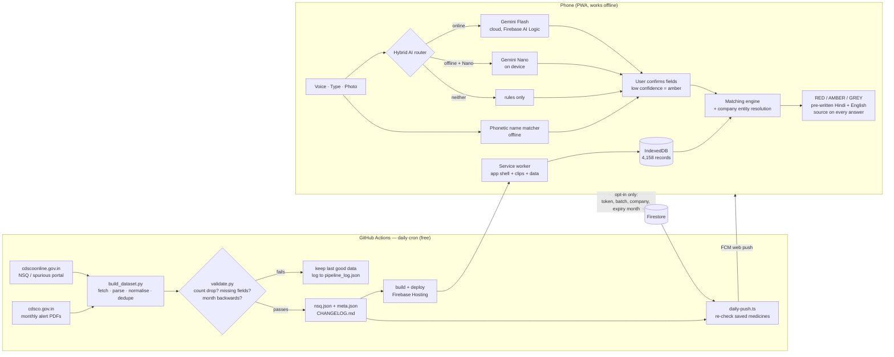
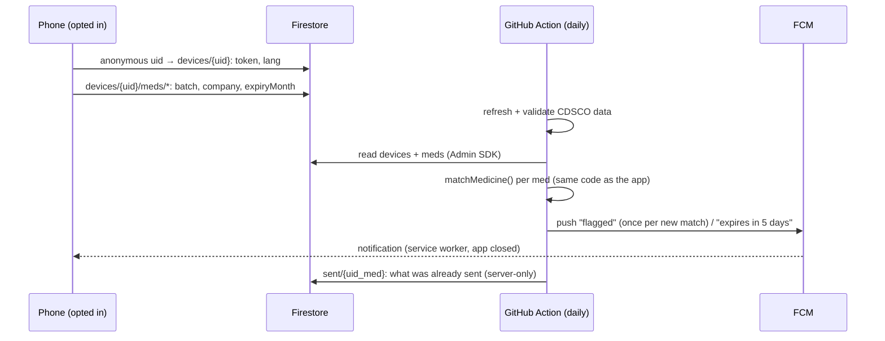

# DawaShield architecture

DawaShield checks medicines at home against official CDSCO "Not of Standard Quality" (NSQ) and spurious-drug alerts. **The colour of every answer is decided by plain, rule-based code on the phone. AI only helps people type less (speech, photo) and explain more.**

## Big picture

## 1. Data pipeline (`data/build_dataset.py`, `data/validate.py`, `.github/workflows/dataset.yml`)

- Runs **every day at 07:00 IST** on GitHub Actions (free). CDSCO publishes alerts about a month late at no fixed date, so a daily check gets new records out as soon as CDSCO does.
- Sources: the CDSCO public NSQ/spurious portal (structured rows) and the monthly alert PDFs (text used to cross-check rows; `pdfMatch`).
- Normalise batch (`B.No: 45A-2` → `45A2`), company names, dedupe repeated listings (`listedTimes`), mark the 55 hand-verified records (`data/verified_records.csv`) as `verified`.
- **Validation gate** (`validate.py`, unit-tested): no records, >10% drop in record count, >1% rows missing required fields, unknown type, malformed month, duplicate ids, or the latest month going backwards → **the new data is not published**; the last good version stays live and the reason is appended to `data/pipeline_log.json`.
- On success: `public/data/nsq.json`, `meta.json` (with `latestMonth`, `lastChecked`, sizes) and a `data/CHANGELOG.md` entry listing every added record; then build + deploy to Firebase Hosting.

## 2. Hybrid AI router (`src/lib/ai.ts`)

| Task | First choice | Fallback | Why |
|---|---|---|---|
| Read strip photo | **Gemini Flash (cloud)** when online | Gemini Nano on device | Small sideways print needs the stronger model; two independent reads are compared. Offline, Nano keeps it working on supported devices. |
| Understand speech | **Phonetic matcher (rules, offline)** | + Nano/Flash candidates when available | Works on any phone with no model; AI only adds candidates. |
| Explain a record | **Pre-written templates (offline, Hindi + English)** | Flash for a richer explanation / follow-up chat when online | Nano cannot write Hindi; templates are always correct and safe. |
| Decide the colour | **Never AI** — matching engine | — | Safety. |

Every AI answer carries the SDK's real `inferenceSource`, shown as **"On this device"** or **"Cloud"** (never "Unknown"). Capability is detected at runtime (`LanguageModel.availability`), and the result screen's "How this answer was made" lists every AI call with source and time.

## 3. Photo pipeline (`src/lib/enhance.ts`, `src/lib/image.ts`, `src/lib/label.ts`)

1. **Auto-crop** to the printed area (edge-energy projection on a small preview).
2. **Enhance** for small/shiny text: grayscale → **glare reduction** (blown highlights pulled to the local mean via an integral image) → **CLAHE** (8×8 tiles, clip limit, bilinear blend) → **unsharp-mask sharpen**.
3. Full read twice (cloud) + zoomed enhanced crop of the B.No/EXP box when small; one more enhanced read if batch/expiry is still unsure.
4. Plain-code checks: keyword-anchored batch (must come after B.No/Batch/Lot), **licence numbers and MFD never accepted as batch/expiry**, expiry must be after MFD.
5. Every field gets a **confidence score** (model score lowered by any failed check). Below 0.75 → amber "please confirm" with the editable field highlighted. A second photo can be merged field by field. A big-button keypad is always one tap away.

## 4. Offline matching engine (`src/lib/match.ts`)

- The full dataset (~0.5 MB gzip) is stored in **IndexedDB**; the service worker precaches the app shell, data and voice clips (~2.7 MB transferred in total).
- Pure TypeScript rules, a few milliseconds per check on 4,158 records; no AI, no WASM, so it runs in any low-end Android browser.

| Input | Result |
|---|---|
| Exact batch + exact/high-confidence company (or matching medicine name when no company) | **RED** |
| Exact batch + medium-confidence company | **AMBER** "possible match, please check with chemist" (never GREY) |
| Exact batch + clearly different company / medicine | **AMBER** (batch numbers repeat across companies) |
| Batch 1 character off, or OCR look-alike (0/O, 1/I/L, 5/S, 8/B, 2/Z) | **AMBER** near-batch |
| Company has official action but this batch is not listed | **AMBER**, scope explained: only listed batches, never "all batches" |
| Nothing | **GREY**: "No official alert found for this batch. This does not mean the medicine is tested safe. CDSCO lists come out late." + next steps |

## 5. Company entity resolution (`src/lib/entity.ts`)

1. Normalise: drop address, `M/s`, `Pvt/Private/Ltd/Limited/LLP/Inc/Co/India`, punctuation; standardise spelling (`Pharmaceuticals/Pharmaceutical/Pharma` → `PHARMA`, `Laboratories` → `LABS`, `Life Sciences` → `LIFESCIENCES`…).
2. Alias table for well-known short forms (GSK, Cadila Healthcare → Zydus Lifesciences, Dr. Reddy's…).
3. **Token-set ratio** (Indel/LCS ratio, as in fuzzywuzzy/rapidfuzz) with typo-tolerant token alignment, plus guards: must share a *distinctive* word (sharing only "Pharma" is not a match); extra distinctive words or a different company type cap confidence.
4. Bands: exact (1.0) · high (≥0.90) · medium (≥0.72) · low.

## 6. Hindi voice (`src/lib/phonetic.ts`)

- Dictionary: every record's brand/generic name + ~370 common Indian brands/generics (2,600+ entries), each with a Devanagari transliteration and phonetic keys.
- Transcript → Latin (Devanagari transliteration) → candidate words and joined neighbours (STT splits names) → **Hindi-aware metaphone-style key** (ph=f, kh=k, bh=b, z=j, soft c/g, vowels dropped after the first) → score = edit-distance similarity on key (60%) + spelling (40%), weighted by how much of the utterance it explains. Top 2–4 shown as big buttons.
- Fixed messages are pre-recorded Sarvam AI (Bulbul) clips in Hindi and English; medicine names are shown on screen, not spoken.

## 7. Push re-check loop (`scripts/daily-push.ts`, `src/lib/pushplan.ts`)

Family: the owner creates `invites/{random code}`; the family member opens the link, accepts, and adds only their own push token under it. Flagged alerts go to both. Users who don't allow push get **"Add expiry to my calendar"** (.ics with an alarm 5 days before expiry).

## 8. Privacy design

- Default: **nothing leaves the phone**. Cabinet and family numbers live in IndexedDB.
- Push is **opt-in** with a clear consent text. Stored in Firestore only: push token, language, batch number, company name, expiry month. **No medicine names, person names, phone numbers or health information.** Turning it off deletes the documents.
- Identity is an **anonymous Firebase Auth uid**. Firestore rules (`firestore.rules`) let each device read/write only its own docs, with field allow-lists and size limits; `sent/` is server-only; `reports/` is write-only.
- Voice is never recorded; photos are never stored. AI calls send only the photo being read, or the official record + the user's question.
- App Check (reCAPTCHA Enterprise) protects the Firebase AI Logic endpoint.
- Everything runs on the free Spark plan: Hosting, Firestore, Auth, FCM; scheduled work on GitHub Actions (no Cloud Functions).
